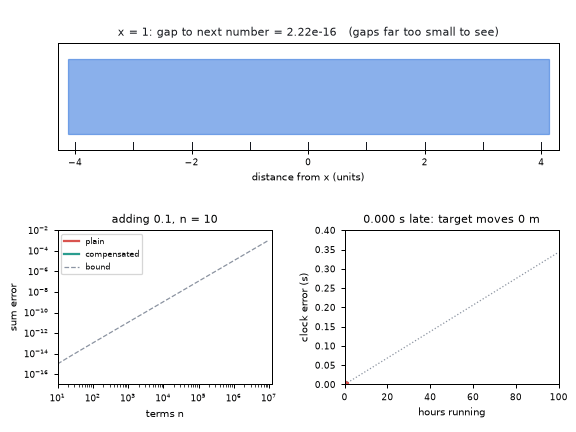
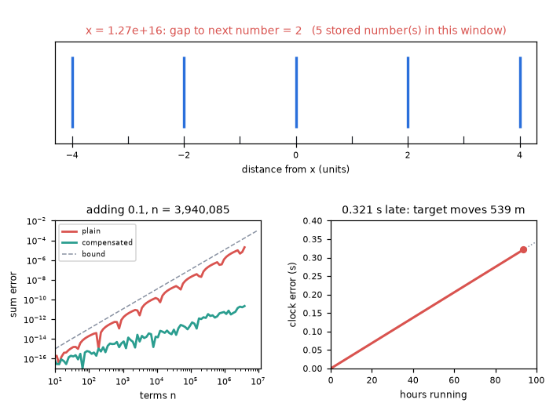
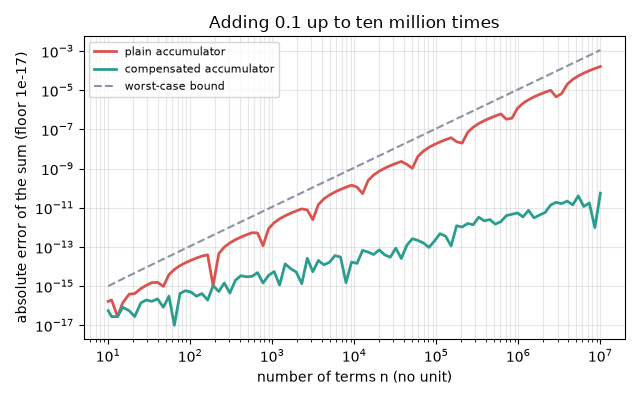
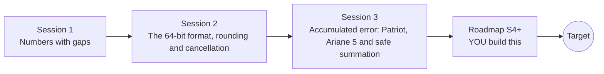

# openfloat

[](https://github.com/KrunalPanchal1995/openfloat/actions/workflows/ci.yml)   [](https://colab.research.google.com/github/KrunalPanchal1995/openfloat/blob/main/sessions/session-01/lesson.ipynb) [](https://krunalpanchal1995.github.io/openfloat/)

**Learn why computers get arithmetic wrong, from 0.1 + 0.2 to the Patriot and Ariane 5 failures.**

openfloat teaches how computers store real numbers, how rounding errors build up, and how two famous failures (Patriot and Ariane 5) come from ordinary number-format limits, using only Python and a browser.

- **Start from zero.** Session 1 needs only school arithmetic and the idea of powers of two.
- **See it happen.** Every session ships a slider app that runs in the browser, with labelled graphs.
- **Learn from real failures.** Patriot clock drift and Ariane 5 overflow are reproduced as small calculations you can run.
- **Build the missing half.** The repo stops at Session 3 on purpose; the roadmap shows the path to the Target.

[Target](#the-target) · [Who is this for](#who-is-this-for) · [Quick start](#quick-start) · [Sessions](#sessions) · [Roadmap](#roadmap) · [Contribute](#contribute) · [Explainer PDF](docs/explainer.pdf)

> **This repo is incomplete on purpose.** Sessions 1 to 3 are here and fully working. The finished Target below is a preview of what the community can build next. We show you the path, not the code. Sessions 4 and up are yours.

## The Target

One animated tour with three linked panels. Top: a window of fixed width 8 on the real 64-bit number line; as the magnitude climbs from 1 to about 1e17 the stored numbers thin out until a single one is left. Bottom left: the error of adding 0.1 up to ten million times, a plain accumulator against a compensated one and the worst-case bound. Bottom right: the Patriot-style clock counter, drifting to about 0.34 s late over 100 hours. Your goal over the coming sessions: build all three panels yourself, then extend them.



*Target: number-line gaps, error growth and Patriot clock drift in one tour*



*A still from the Target: gap of 2 near 1e16, summation error and clock drift*



*Error of adding 0.1 up to ten million times: plain versus compensated versus the bound*

Try it live:

- [Math Visual Studio: floating point, error and conditioning (Atlas S28)](https://krunalpanchal1995.github.io/studio/#atlas?ch=S28&ex=1)
- [Math Visual Studio: the best step size for a difference quotient (Atlas S28, example 2)](https://krunalpanchal1995.github.io/studio/#atlas?ch=S28&ex=2)

How the Target was made is shown only as a path in [promo/roadmap.md](promo/roadmap.md).

## Who is this for
**secondary school to diploma / undergraduate (levels 3-5).** Topic area: Mathematics and Visual Problem-Solving.

Prerequisites:

- Powers of two and basic algebra (school level).
- Python 3.10 or newer; if `python --version` works, you are ready. PRIMER.md explains the rest.
- No prior GitHub or numerical-methods experience is needed.

New to Python? Read [PRIMER.md](PRIMER.md) first (10 minutes).

## Quick start

No installation knowledge needed. You need [Git](https://git-scm.com/downloads) and [Python 3.10+](https://www.python.org/downloads/) (Windows: tick "Add Python to PATH"). On Mac and Linux type `python3` wherever this page says `python`.

```bash
git clone https://github.com/KrunalPanchal1995/openfloat.git
cd openfloat
python start.py 1
```

`start.py` creates a private environment, installs what is needed and runs Session 1 with its checkpoint. Next: `python start.py 2`, `python start.py 3`, or `python start.py test` to check everything. Only a checkpoint: `python start.py check 1`.

Four lines turn the idea of Session 1 into a result (they work as they are): Save it as `try.py` and run it with `python start.py run try.py` (this uses the private environment, where NumPy is installed):

```python
import numpy as np
print(0.1 + 0.2 == 0.3)               # -> False
print(np.spacing(1.0))                # -> 2.220446049250313e-16  the gap above 1
print(np.spacing(1e16))               # -> 2.0  the gap above ten quadrillion
```

Every session also opens in your browser with sliders (no install): [live apps](https://krunalpanchal1995.github.io/openfloat/). Or use the Colab badge above for the notebook.

## Sessions

| # | Session | Model level | Time | Live app |
|---|---|---|---|---|
| 1 | [Numbers with gaps](sessions/session-01/README.md) | Level 1: conceptual interactive model | 60 min | [open](https://krunalpanchal1995.github.io/openfloat/session-01/) |
| 2 | [The 64-bit format, rounding and cancellation](sessions/session-02/README.md) | Level 2: mathematical engineering model | 75 min | [open](https://krunalpanchal1995.github.io/openfloat/session-02/) |
| 3 | [Accumulated error: Patriot, Ariane 5 and safe summation](sessions/session-03/README.md) | Level 3: simulation and validation | 90 min | [open](https://krunalpanchal1995.github.io/openfloat/session-03/) |

Each session follows the same six steps: A real-world problem, B concept and theory, C visual explanation, D interactive simulation, E worked example and experiment, F assessment and design challenge. Each ends with `checkpoint.py`, which prints `PASS` or `FAIL` against reference numbers. Session 3 also contains the real-world mini-project: **Audit a short calculation for cancellation and overflow**.

## Architecture



| Folder or file | What is inside |
|---|---|
| `sessions/` | three sessions: README (A-F), `lesson.py`, notebook, live app, exercises, activity sheet, checkpoint |
| `promo/` | the Target: media, live links, and the roadmap (path only) |
| `docs/` | `explainer.tex` and the built `explainer.pdf` |
| `tests/` | runs every lesson and checkpoint headless |
| `start.py` | one command to set up and run anything |
| `QUALITY.md`, `RUBRIC.md` | the quality checklist and the scoring rubric |
| `.github/` | CI, PDF build, Pages deploy, issue and PR templates |

## Roadmap

| Milestone | What you will build | Difficulty |
|---|---|---|
| Session 4: Other number formats | A decoder that works for any width of sign, exponent and fraction fields. | intermediate |
| Session 5: Neumaier summation and bad orderings | A compensated sum that is robust to term order. | intermediate |
| Session 6: Interval arithmetic | A small interval class for + - * / and sqrt with outward rounding. | advanced |
| Session 7: Conditioning of a linear system | A study of Hilbert matrix systems of growing size. | advanced |
| Session 8: Count ticks as integers | A clock model that stores whole ticks and converts to seconds only on reading. | intermediate |

Full detail with a checkpoint per milestone: [promo/roadmap.md](promo/roadmap.md).

## Contribute
New to GitHub? Read [CONTRIBUTING.md](CONTRIBUTING.md); it starts from zero. Pick an issue labelled `good first issue`. Translations into Hindi, Telugu, Tamil and Malayalam are welcome.

<details>
<summary>Development</summary>

```bash
python start.py test        # runs every lesson and checkpoint
```
Lessons use `# %%` cell markers so they open as notebooks in VS Code. See [QUALITY.md](QUALITY.md) for the standard every session meets.
</details>

## License
MIT. See [LICENSE](LICENSE). Media in `promo/media` is (c) Krunal Panchal, CC BY 4.0.

## Acknowledgments
Part of the [PAN IIT OSS](https://hellofoss.tech-iitb.org/projects) open-source teaching collection, modelled on the structure of [openspline](https://github.com/openspline/openspline). Built on ideas from the Math Visual Studio at https://krunalpanchal1995.github.io/studio/.
