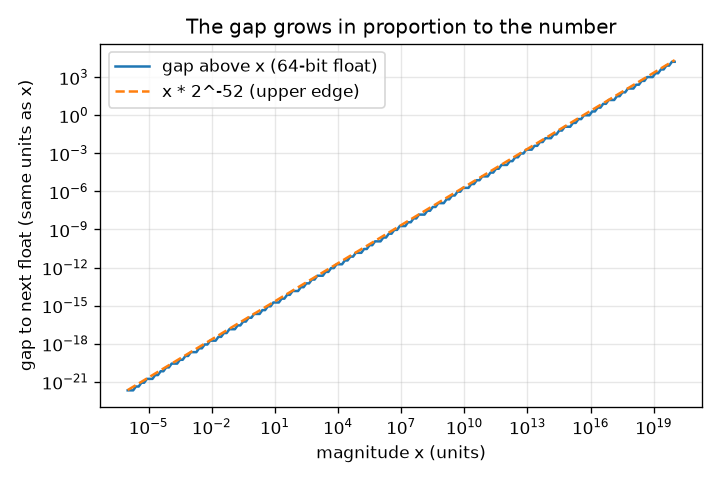
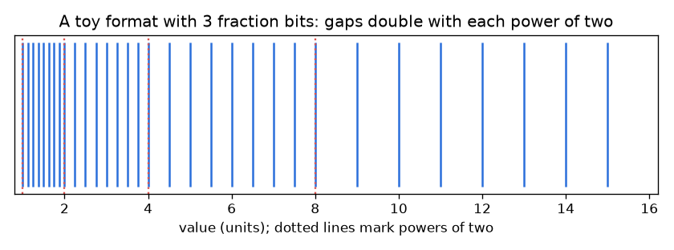

# Session 1: Numbers with gaps

*Level 1 (conceptual interactive model) · about 60 minutes · openfloat*

> This is a simplified educational model. It is not a validated design tool and must not be used for real structures, electrical installations, vehicles, industrial processes or medical decisions.

**Prerequisites**

- Powers of two (2, 4, 8, 16 ...) and decimal fractions.
- You have read PRIMER.md and run `python start.py 1` once.

**Learning objectives.** After this session you can:

- Explain why 0.1 + 0.2 is not exactly 0.3 on a computer.
- Describe stored numbers as points on a number line with gaps between them.
- Predict how the gap grows with the size of the number.
- Compare computed numbers with a tolerance instead of ==.

## A. Real-world problem
Type 0.1 + 0.2 into almost any programming language. The answer is 0.30000000000000004, and 0.1 + 0.2 == 0.3 is False. A spreadsheet, a phone calculator and a flight computer all store numbers using a limited number of binary digits. Between two storable numbers there is a gap, and every result has to be rounded to a storable number. How big are the gaps, where are they large, and how do we program safely around them?

## B. Concept and theory
Computers write numbers in binary. A decimal fraction such as 0.1 becomes the repeating binary pattern 0.000110011..., which never ends, just as 1/3 = 0.333... never ends in decimal. A computer keeps only a fixed number m of binary digits after the leading 1 (the fraction bits), so it can store only certain numbers. Between 2^k and 2^(k+1) the stored numbers are equally spaced, 2^m of them, with gap 2^(k-m). When x doubles, the gap doubles. So the gap is small near 0 and large for big numbers, but the relative gap (gap divided by x) stays between 2^-m / 2 and 2^-m. The 64-bit format used by Python and NumPy has m = 52. A result that falls between two stored numbers is rounded to a nearby stored one, which is the source of every effect in this repo. Instead of testing a == b for computed numbers, test whether they differ by less than a tolerance chosen relative to their size.

| Symbol | Meaning | Unit |
|---|---|---|
| m | number of fraction bits (52 for 64-bit floats) | no unit |
| k | exponent: x lies in [2^k, 2^(k+1)) | no unit |
| gap | distance from x to the next stored number | same unit as x |
| relative gap | gap divided by x | no unit |

**Assumptions**

- We look at positive numbers that are not tiny or huge (no overflow or underflow yet).
- The toy formats in the app use the same rule as 64-bit floats, with fewer fraction bits.
- Rounding picks a nearby stored number; we do not study which one yet.

$$ \mathrm{gap}(x)=2^{k-m},\qquad 2^k\le x<2^{k+1} $$

$$ \frac{2^{-m}}{2}<\frac{\mathrm{gap}(x)}{x}\le 2^{-m} $$

$$ \varepsilon_{\mathrm{mach}}=\mathrm{gap}(1)=2^{-52}\approx 2.22\times10^{-16}\quad(m=52) $$

## C. Visual explanation
The first figure shows a toy format with only 3 fraction bits between 1 and 16: 8 stored numbers between 1 and 2 (close together), 8 between 8 and 16 (far apart), so the ticks spread out as the numbers grow. The second plots the real 64-bit gap against the size of the number on log-log axes: a straight line of slope 1, because the gap is proportional to the number. At 1 the gap is 2.2e-16; at 1e16 it is already 2.

*The real 64-bit gap grows in proportion to the number (log-log axes).*

*A toy format with 3 fraction bits: gaps double at every power of two.*

## D. Interactive simulation
Run the lesson (`python start.py 1`), then open the live app: [Session 1: numbers with gaps](https://krunalpanchal1995.github.io/openfloat/session-01/) (or `app.html` in this folder). Move the exponent and fraction-bit sliders, watch the blue ticks and the green next-number marker in the picture, then open the graph view and read the staircase.

**Challenge.** Make the gap just above the red marker at most 0.1 units, using as few fraction bits as you can.

## E. Worked example and experiment
**Problem.** Find the gap above 1000 in the 64-bit format by hand, then check it by computer. Also explain why 2^53 + 1 equals 2^53.

1. 1000 lies between 512 = 2^9 and 1024 = 2^10, so k = 9.
2. gap = 2^(k - 52) = 2^(9 - 52) = 2^-43.
3. 2^-43 = 1.137e-13. The relative gap is 1.137e-13 / 1000 = 1.137e-16, between 1.1e-16 and 2.2e-16 as predicted.
4. For 2^53: k = 53, so gap = 2^(53 - 52) = 2. The next number after 2^53 is 2^53 + 2, so 2^53 + 1 falls halfway and is rounded back to 2^53.

**Answer.** The gap above 1000 is 2^-43, about 1.137e-13 (relative 1.137e-16). Above 2^53 (about 9.0e15) the gap is 2, so whole numbers can no longer all be stored.

**Experiment.** In Python print np.spacing(1000.0) and compare it with 2.0**-43. Then print 0.1 + 0.2 - 0.3 (you get about 5.55e-17, exactly one gap: the gap above 0.3 is 2^-54). Real money, time or distance values behave the same way. Model versus reality: the model says exactly where the gaps are; what it cannot tell you alone is how rounding errors from many operations combine, which is the subject of the next sessions.

## F. Assessment and design challenge
**Question type A: Conceptual.** Why can 0.5 be stored exactly but 0.1 cannot?

Hint

Write both in binary. Which one ends?

Step-by-step solution

0.5 is 2^-1, which is 0.1 in binary and ends. 0.1 in decimal is 1/10, and 10 has the factor 5, which no power of two contains, so in binary it repeats forever (0.000110011...). Only 53 significant binary digits are kept, so the stored value 0.1000000000000000055... is slightly different from 0.1.

**Question type B: Numerical.** What is the gap just above 1000.0 in a 64-bit float? What is the relative gap? Does your answer pass a sanity check?

Hint

Find k with 2^k <= 1000 < 2^(k+1), then use gap = 2^(k - 52).

Step-by-step solution

k = 9 because 512 <= 1000 < 1024. gap = 2^-43 = 1.14e-13 (same unit as the number). Relative gap = 1.14e-13 / 1000 = 1.14e-16. Sanity check: it must lie between 2^-53 = 1.1e-16 and 2^-52 = 2.2e-16, and it does.

**Question type C: Graph and simulation interpretation.** In the graph view with 3 fraction bits, what is the gap for numbers in [8, 16) and how many numbers are stored there? What changes if you use 5 fraction bits?

Hint

Read the height of the staircase between x = 8 and x = 16.

Step-by-step solution

With m = 3 the gap in [8, 16) is 2^(3 - 3) = 1 and there are 2^3 = 8 stored numbers (8, 9, ..., 15). With m = 5 the gap is 2^(3 - 5) = 0.25 and there are 32 numbers. Each extra bit halves every gap and doubles the count.

**Question type D: Design and optimisation challenge.** Design: a toy sensor must store lengths from 1 to 16 units with a gap of at most 0.1 units everywhere. How many fraction bits m are needed? What is the cost of using more?

Hint

The largest gap is in [8, 16): 2^(3 - m). Solve 2^(3 - m) <= 0.1.

Step-by-step solution

We need 2^(3 - m) <= 0.1, so m >= 3 + log2(10) = 6.32, so m = 7 (gap 2^-4 = 0.0625). m = 6 gives 0.125, which is too big. Cost: every extra bit doubles the number of stored values, so more memory per number. Trade-off: near 1 the gap with m = 7 is 2^-7 = 0.0078, much finer than needed, which shows that a floating format spends precision relative to size, not evenly.

Score yourself with [RUBRIC.md](../../RUBRIC.md). Print the [activity sheet](activity_sheet.md) to work on paper.

## Common misconceptions
| Common misconception | What is actually true |
|---|---|
| Computers store 0.1 exactly and the arithmetic is wrong. | The stored number is already slightly different from 0.1 (0.1000000000000000055...). The addition is correct for the stored numbers. |
| The gap between stored numbers is the same everywhere. | The gap doubles every time the number doubles; the relative gap stays about the same. |
| More digits printed means a more accurate number. | Printing 30 digits only shows the stored value exactly; it does not make the result any more accurate. |
| Use == to check if two computed numbers are equal. | Compare with a tolerance relative to the size of the numbers, and add an absolute tolerance for values near zero. |

## Glossary
- **binary**: numbers written with the digits 0 and 1; place values are powers of two
- **fraction bits**: binary digits kept after the leading 1; 52 in a 64-bit float
- **gap**: distance from a stored number to the next one
- **relative gap**: the gap divided by the number itself
- **machine epsilon**: the gap above 1: 2^-52, about 2.22e-16
- **tolerance**: an agreed small difference below which two numbers count as equal

## Finish
1. Do the three coding tasks in [exercises.md](exercises.md).
2. Run `python start.py 1` again after your changes. It ends with the checkpoint; when it prints `PASS`, you are done. (Checkpoint only: `python start.py check 1`.)

Next: [Session 2](../session-02/README.md)
