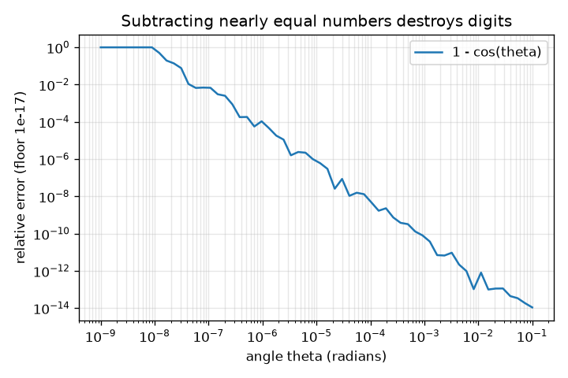
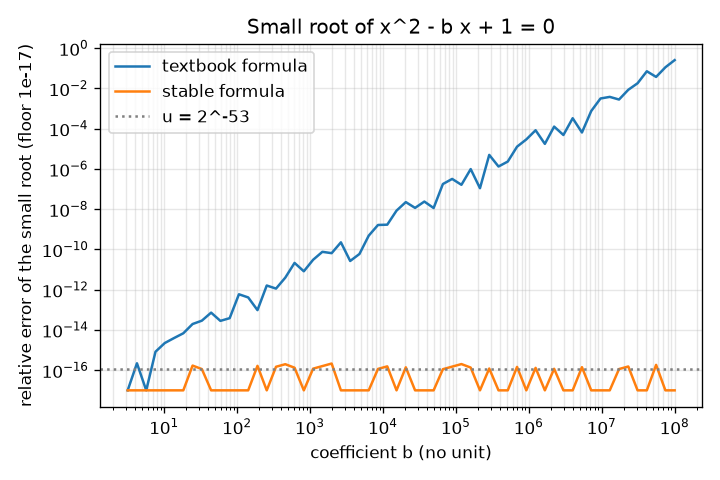

# Session 2: The 64-bit format, rounding and cancellation

*Level 2 (mathematical engineering model) · about 75 minutes · openfloat*

> This is a simplified educational model. It is not a validated design tool and must not be used for real structures, electrical installations, vehicles, industrial processes or medical decisions.

**Prerequisites**

- Session 1: gaps between stored numbers.
- Quadratic equations and the formula for their roots; logarithms base 10.

**Learning objectives.** After this session you can:

- Read the 1 sign bit, 11 exponent bits and 52 fraction bits of a 64-bit float.
- State and compute machine epsilon 2^-52 with NumPy, and the relative rounding error bound 2^-53.
- Recognise catastrophic cancellation and repair a formula (quadratic root, 1 - cos).
- Explain overflow and underflow and the range of a 64-bit float.

## A. Real-world problem
An engineer solves x^2 - 1,000,000 x + 1 = 0 with the textbook formula and finds the small root is 1.0000076e-6; the true value is 1.000000000001e-6. A physicist computes 1 - cos(0.00000001) and gets exactly 0. Both used correct formulas on a correct computer. What went wrong, how many digits did we lose, and what is the rule that tells us which formulas to avoid? And what happens if a number is simply too large or too small for the format?

## B. Concept and theory
A normal 64-bit number is stored in 64 bits: 1 sign bit s, 11 exponent bits e (a whole number from 1 to 2046) and 52 fraction bits f. Its value is (-1)^s (1 + f / 2^52) 2^(e - 1023). The leading 1 is implied. Machine epsilon 2^-52 (about 2.22e-16) is the gap above 1. Rounding to the nearest stored number makes a relative error of at most u = 2^-53 (about 1.1e-16): fl(x) = x (1 + delta) with |delta| <= u. A single operation is therefore accurate to about 16 digits. Subtracting two nearly equal numbers is the dangerous operation: the leading digits cancel exactly, and what remains is dominated by the old rounding errors, so the relative error of the difference can be huge (catastrophic cancellation). The remedy is algebra: rewrite the formula so that it adds like-signed terms. For x^2 - b x + c = 0 with b > 0 large, the small root (b - sqrt(b^2 - 4c))/2 subtracts two nearly equal numbers; compute the large root (b + sqrt(b^2 - 4c))/2 first and then use x1 x2 = c to get x2 = c / x1. For small angles, 1 - cos(t) = 2 sin^2(t / 2) avoids the subtraction. The range of a 64-bit float is about 2.2e-308 (smallest normal) to 1.8e308 (largest). Larger results become inf (overflow); smaller ones lose digits as subnormal numbers (down to 5e-324) and then become 0 (underflow). sqrt(x^2 + y^2) overflows for x = 3e200 even though the answer, 5e200, is representable; scale first.

| Symbol | Meaning | Unit |
|---|---|---|
| s, e, f | sign bit, exponent field (11 bits), fraction field (52 bits) | no unit |
| u | unit round-off 2^-53, about 1.1e-16 | no unit |
| eps | machine epsilon 2^-52, about 2.22e-16 | no unit |
| b, c | coefficients of x^2 - b x + c = 0 | no unit |
| x1, x2 | large and small root | no unit |
| t | angle | radians |

**Assumptions**

- Normal numbers only in the format formula (subnormals are mentioned, not decoded).
- Round-to-nearest, the default in NumPy and Python.
- b > 0 and b^2 much larger than 4c in the quadratic example.
- The 60-digit decimal result in the lesson is the trusted reference.

$$ x=(-1)^s\left(1+\frac{f}{2^{52}}\right)2^{\,e-1023} $$

$$ \mathrm{fl}(x)=x(1+\delta),\quad |\delta|\le u=2^{-53}\approx1.1\times10^{-16} $$

$$ x_1=\frac{b+\sqrt{b^2-4c}}{2},\qquad x_2=\frac{c}{x_1}\qquad\text{(instead of }x_2=\tfrac{b-\sqrt{b^2-4c}}{2}\text{)} $$

$$ 1-\cos t=2\sin^2\!\left(\frac t2\right) $$

$$ \text{relative error of the textbook small root}\ \lesssim\ u\,b^2/c\quad(b^2\gg 4c) $$

## C. Visual explanation
The first figure plots the relative error of the small root of x^2 - b x + 1 = 0 against b on log-log axes. The textbook formula is a rising line (about 100 times worse every time b grows 10 times); the stable formula stays at the level of the rounding unit, about 1e-16. At b = 1e9 and above the textbook root has no correct digits. The second figure plots the error of 1 - cos(t) for small angles: it grows as t shrinks, reaching 100 percent at t = 1e-8.

*Error of 1 - cos(t) for small angles t: digits are destroyed by the subtraction.*

*Relative error of the small root of x^2 - b x + 1 = 0: textbook formula versus stable formula.*

## D. Interactive simulation
Run the lesson (`python start.py 2`), then open the live app: [Session 2: cancellation in the quadratic formula](https://krunalpanchal1995.github.io/openfloat/session-02/) (or `app.html` in this folder). Slide p (b = 10^p) and read how many digits the textbook root keeps, then switch to the graph view and see the error line rise about 2 decades per step. Change c and see how little it matters.

**Challenge.** Find a setting where the textbook formula has a relative error above 1e-6.

## E. Worked example and experiment
**Problem.** (a) Decode -6.5 into sign, exponent field and fraction field. (b) For x^2 - 1e6 x + 1 = 0, compute the small root with both formulas and measure the error. (c) Show why 1 - cos(1e-8) is exactly 0.

1. (a) -6.5 = -1.625 x 2^2. Sign bit s = 1. True exponent 2, so e = 2 + 1023 = 1025. Fraction: 1.625 = 1 + 0.625, so f = 0.625 x 2^52 (hexadecimal a000000000000).
2. (b) b = 1e6, c = 1. sqrt(b^2 - 4) = 999999.999998, very close to b = 1e6. The textbook small root (b - sqrt(...))/2 subtracts two numbers equal in their first 12 digits and gives 1.00000761449e-6. The stable route gives x1 = 1e6 (to 16 digits) and x2 = 1 / x1 = 1.000000000001e-6, which agrees with 60-digit arithmetic.
3. Relative error of the textbook root = 7.6e-6, so only about 5 correct digits remain (11 digits lost). The estimate u b^2 / c = 1.1e-4 is an upper-bound estimate and the measured error is below it.
4. (c) For t = 1e-8, cos t = 1 - t^2/2 = 1 - 5e-17. The gap just below 1 is 2^-53 = 1.1e-16, so 1 - 5e-17 is closer to 1 than to the next number below it (distance 5e-17 against 6e-17). cos(1e-8) is stored as 1.0 and 1 - cos = 0. The stable formula gives 2 sin^2(5e-9) = 5.0e-17.

**Answer.** -6.5: s = 1, e = 1025, f = 0.625 x 2^52. The textbook small root of x^2 - 1e6 x + 1 has relative error 7.6e-6 (about 5 correct digits); the stable formula is correct to about 16. 1 - cos(1e-8) computes to 0 although the true value is 5e-17.

**Experiment.** Compute the small root of x^2 - b x + 1 = 0 in Python for b = 1e2, 1e4, 1e6, 1e8 with both formulas and compare with 60-digit decimal arithmetic. Model versus reality: the model u b^2 / c tells you the worst-case size and the growth rate (100 times per decade of b); the real error is smaller and irregular because individual roundings partly cancel.

## F. Assessment and design challenge
**Question type A: Conceptual.** Why does computing 1 - cos(1e-8) give exactly 0 although each single operation is accurate to 16 digits?

Hint

How far below 1 is cos(1e-8), compared with the gap just below 1?

Step-by-step solution

cos(1e-8) is 1 - 5e-17. That is closer to 1 than to the next stored number below 1 (which is 1.1e-16 below), so rounding stores exactly 1. The rounding itself was accurate to 16 digits in cos, but the subtraction 1 - cos then exposes the rounding error: the whole answer was in the digits that were lost. The remedy is to avoid the subtraction: 2 sin^2(t / 2).

**Question type B: Numerical.** Decode 0.15625 (that is 5/32): give s, e and the fraction field f. Sanity check by rebuilding the value.

Hint

Write 0.15625 = 1.25 x 2^-3. Then e = -3 + 1023 and f = 0.25 x 2^52.

Step-by-step solution

0.15625 = 1.25 x 2^-3. s = 0. e = 1023 - 3 = 1020. f = 0.25 x 2^52 = 2^50 (hexadecimal 4000000000000). Check: (1 + 2^50 / 2^52) x 2^(1020 - 1023) = 1.25 x 0.125 = 0.15625.

**Question type C: Graph and simulation interpretation.** From the app graph view (c = 1), roughly how does the error of the textbook small root change when p increases by 1? About how many digits are correct at p = 6?

Hint

Read the red curve on a log scale: one unit on the y axis is a factor 10.

Step-by-step solution

The curve rises by about 2 units per unit of p: the error grows about 100 times for each 10 times increase of b, matching u b^2 / c. At p = 6 the error is about 7.6e-6, so about 5 correct digits remain. The stable formula stays at about 1e-16 (16 digits).

**Question type D: Design and optimisation challenge.** Design: a program must evaluate 1 - cos(t) for every angle from 1e-9 to 1 radian with a relative error below 1e-12. Choose the formula(s). Where, if anywhere, is the textbook form acceptable?

Hint

The error of the textbook form is about 2.2e-16 / t^2 (worst-case estimate). Solve for t.

Step-by-step solution

The estimate 2.2e-16 / t^2 <= 1e-12 gives t >= sqrt(2.2e-4) = 0.015. So the textbook form is acceptable only for t above about 0.015; for smaller angles use 2 sin^2(t / 2), which has a relative error of a few times 1e-16 for all t. The simplest safe design uses 2 sin^2(t / 2) everywhere: it costs the same as cos and has no cancellation. Trade-off: the identity must be checked by test (the checkpoint does), and a formula that is clearer to read may be worth a comment.

Score yourself with [RUBRIC.md](../../RUBRIC.md). Print the [activity sheet](activity_sheet.md) to work on paper.

## Common misconceptions
| Common misconception | What is actually true |
|---|---|
| Floating point errors are random noise. | Rounding is deterministic and follows a bound (relative error at most 2^-53 per operation). The same program gives the same wrong answer every time. |
| A bigger data type always fixes it. | More bits give more digits but a badly arranged formula still loses them. Rewriting the formula often matters more. |
| Subtraction is exact in floating point. | Subtraction of nearby numbers is exact, but it exposes earlier rounding errors, so the relative error of the result can be large. |
| Overflow only happens with huge data. | sqrt(x^2 + y^2) overflows for x = 3e200 although the answer, 5e200, is a perfectly valid number. |

## Glossary
- **sign, exponent, fraction**: the three fields of a floating-point number: 1, 11 and 52 bits in a 64-bit float
- **unit round-off u**: the largest relative error of one rounding, 2^-53
- **catastrophic cancellation**: loss of leading digits when two nearly equal numbers are subtracted
- **stable formula**: an algebraically equal formula that does not lose digits
- **overflow**: result too large for the format; it becomes inf
- **underflow**: result too small for the format; it loses digits and then becomes 0
- **subnormal**: tiny number below 2.2e-308 stored with fewer digits

## Finish
1. Do the three coding tasks in [exercises.md](exercises.md).
2. Run `python start.py 2` again after your changes. It ends with the checkpoint; when it prints `PASS`, you are done. (Checkpoint only: `python start.py check 2`.)

Next: [Session 3](../session-03/README.md)
