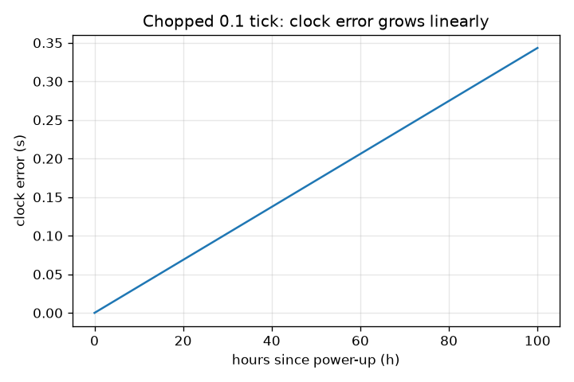
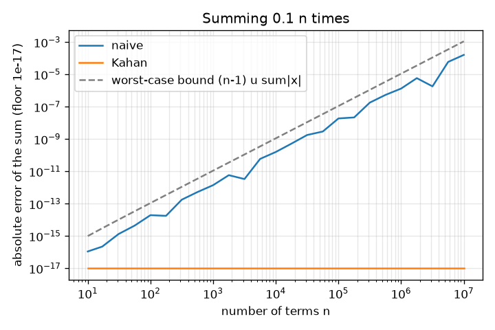

# Session 3: Accumulated error: Patriot, Ariane 5 and safe summation

*Level 3 (simulation and validation) · about 90 minutes · openfloat*

> This is a simplified educational model. It is not a validated design tool and must not be used for real structures, electrical installations, vehicles, industrial processes or medical decisions.

**Prerequisites**

- Session 1: gaps between stored numbers.
- Session 2: relative rounding error and cancellation.

**Learning objectives.** After this session you can:

- Measure how rounding error grows when 0.1 is added ten million times, and compare it with the worst-case bound.
- Use Kahan (compensated) summation and math.fsum to remove most of that error.
- Reproduce the commonly cited Patriot clock drift (about 0.34 s after 100 hours) from a 0.1 chopped to 23 binary places.
- Show how a conversion to a 16-bit integer wraps, and add a range check.

## A. Real-world problem
Two famous failures need no exotic mathematics. In February 1991 a Patriot air-defence battery in Dhahran had been running for about 100 hours; its clock counted time in tenths of a second, and 0.1 cannot be stored exactly in binary. The commonly cited analysis says the tiny error added at every tick had grown to about a third of a second, enough to shift where the system looked for an incoming Scud. In June 1996 the first Ariane 5 flight was lost when software raised an exception after an unprotected conversion of a 64-bit floating-point value to a 16-bit signed integer. Can we reproduce the mechanisms with a few lines of code, and learn the defences? This is a simplified educational model, not an account of either system; read the official reports for the full stories.

## B. Concept and theory
Naive (recursive) summation adds one term at a time, and every addition rounds, adding an error of up to u times the partial sum. The standard worst-case bound for n terms is (n - 1) u times the sum of the absolute values; the error can grow in proportion to n, and the measured error is often smaller. Kahan summation carries a correction c: for each x, y = x - c; t = s + y; c = (t - s) - y; s = t. It captures the part of y lost in the addition and subtracts it next time; its error bound is about 2u times the sum of absolute values, independent of n, plus a term of order n u^2. math.fsum keeps exact partial sums and rounds once. For the Patriot calculation, time was counted in ticks of 0.1 s. With 0.1 chopped (not rounded) to q binary places the stored tick is 0.1 - delta where delta is the chopped-off remainder; with the commonly cited 24-bit register holding 23 places after the point, delta = 0.1 x 2^-20, about 9.5e-8 s. After h hours there are 36000 h ticks, so the clock is late by 36000 h delta, a straight line in time. At 100 hours that is 0.343 s, and at the commonly cited Scud speed of about 1676 m/s the target moves about 575 m, more than half a kilometre, in that time. For the integer conversion: a 16-bit signed integer holds -32768 to 32767. An unchecked conversion of a larger value can wrap around modulo 65536 (for example 40000 becomes -25536) or, in some languages, raise an exception. The defence is to check the range first and then choose: raise, saturate, or report.

| Symbol | Meaning | Unit |
|---|---|---|
| n | number of terms in a sum | no unit |
| u | unit round-off 2^-53 | no unit |
| q | binary places kept after the point (23 in the commonly cited Patriot layout) | no unit |
| delta | error per 0.1 s tick after chopping | s |
| h | hours of operation | h |
| v | speed of the target (about 1676 m/s, commonly cited) | m/s |

**Assumptions**

- Counting in ticks of exactly 0.1 s; real systems differ in detail (this is a simplified model).
- Chopping (truncation), not rounding, of 0.1 to q places.
- The target moves in a straight line at constant speed.
- For Ariane 5 only the established fact is modelled: an unprotected conversion of a value too large for 16 bits.

$$ |E_n|\le (n-1)\,u\sum_{i=1}^{n}|x_i|\qquad\text{(recursive summation, worst case)} $$

$$ y=x-c,\quad t=s+y,\quad c=(t-s)-y,\quad s=t\qquad\text{(Kahan)} $$

$$ \delta=0.1-\frac{\lfloor 0.1\cdot 2^{q}\rfloor}{2^{q}},\qquad \delta(q{=}23)=0.1\cdot 2^{-20}\approx 9.54\times10^{-8}\ \mathrm{s} $$

$$ \text{clock error}=36000\,h\,\delta,\qquad \text{distance}=v\times\text{clock error} $$

$$ \text{wrap}(x)=\big((x+32768)\bmod 65536\big)-32768 $$

## C. Visual explanation
The first figure plots the absolute error of the running sum of 0.1 against n on log-log axes, for the naive sum and for Kahan, with the worst-case bound as a dashed line. The naive error rises roughly in proportion to n and stays below the bound (at n = 10 million the measured error is 1.6e-4 against a bound of 1.1e-3); Kahan and fsum stay at 0 (below the plot floor). The second figure plots the Patriot clock error against hours: a straight line reaching 0.343 s at 100 hours.

*Clock error against hours for 0.1 chopped to 23 binary places: a straight line, 0.343 s at 100 hours.*

*Error of the running sum of 0.1 against n: naive grows with n below the worst-case bound; Kahan is exact at these counts.*

## D. Interactive simulation
Run the lesson (`python start.py 3`), then open the live app: [Session 3: the Patriot clock drift](https://krunalpanchal1995.github.io/openfloat/session-03/) (or `app.html` in this folder). Slide the hours and the number of binary places and watch the clock error and the distance a target covers in the counter view; open the graph view and compare your line with the 23-place line.

**Challenge.** Find the smallest number of binary places that keeps the clock error below 0.01 s after 100 hours.

## E. Worked example and experiment
**Problem.** (a) Compute the Patriot clock error after 100 hours and the distance a 1676 m/s target covers in that time, from 0.1 chopped to 23 places. (b) What does 40000 become in a 16-bit signed integer? (c) State the measured error of summing 0.1 ten million times, naive versus Kahan.

1. (a) 0.1 = 0.0001100110011... in binary. Chopping at 23 places leaves a remainder of 0.1 x 2^-20 = 9.54e-8 s per tick (checked in the lesson with exact fractions).
2. 100 hours = 100 x 3600 s = 360000 s = 3,600,000 ticks. Clock error = 3,600,000 x 9.5367e-8 = 0.3433 s.
3. Distance = 1676 m/s x 0.3433 s = 575 m, about 0.58 km, in line with the commonly cited 'about half a kilometre'.
4. (b) 40000 is above 32767. Wrap: (40000 + 32768) mod 65536 - 32768. First 72768 mod 65536 = 7232, then 7232 - 32768 = -25536. A value of 40000 becomes -25536.
5. (c) Ten million terms: the exact reference is 1,000,000 (rounded to a 64-bit float). The naive sum is off by 1.6e-4, below the worst-case bound 1.1e-3 (about 7 times lower). Kahan and math.fsum are off by 0.0.

**Answer.** Clock error 0.343 s after 100 hours; the target moves about 575 m. 40000 wraps to -25536. Summing 0.1 ten million times naively is off by about 1.6e-4; Kahan and fsum give the correctly rounded 1,000,000.

**Experiment.** Sum 0.1 one million times in Python with a plain loop, with the lesson's Kahan routine and with math.fsum, and compare them with 100000.0. Then print the wrapped and the saturated value of 40000 in 16 bits. Model versus reality: the Patriot model predicts a straight-line clock drift and the commonly cited 0.34 s; the real system had other details (it tracked velocity and range gates and had different software paths), so only the mechanism, not the full incident, is modelled here. The worst-case bound is never reached by this data: it is a safe upper limit, not a prediction.

## Real-world application and mini-project: Audit a short calculation for cancellation and overflow
A colleague hands you two lines of code used in a sensor pipeline. (1) The variance of readings is computed as mean(x^2) - mean(x)^2; the readings are 1e9 + [4, 7, 13, 16] (a large offset with small variation, true variance 22.5). (2) The length of a vector is computed as sqrt(sum(x^2)); one vector is [3e200, 4e200] (true length 5e200). Use `variance_naive`, `variance_two_pass`, `norm_naive` and `norm_scaled` from Session 3. Show what goes wrong, say which of the two problems is cancellation and which is overflow, and show the fixes.

**Deliverable:** A script that prints, for each of the two calculations, the naive result, the fixed result and the true value, then names the failure (cancellation or overflow) and explains in two sentences why the fix works. Add one more case of your own (for example 1 - cos for a tiny angle) and fix it too.

**Success looks like:** The naive variance is negative (-128.0), the two-pass variance is 22.5, the naive norm is inf, the scaled norm is 5e200 within 1e-15 relative, and your own extra case shows a naive and a fixed value that differ by more than 1e-6 relative.

## F. Assessment and design challenge
**Question type A: Conceptual.** Why does the error of the naive sum keep growing while Kahan's stays flat? Why does it not matter that 0.1 itself is not exactly 0.1 in this comparison?

Hint

Where does the part lost in each addition go in each method? What is the reference value?

Step-by-step solution

In the naive sum, each addition rounds away part of the term and that part is gone for good, so errors accumulate (up to n of them). Kahan stores the lost part in c and adds it into the next term, so only a bounded error remains. The reference is exact_repeat_sum: n times the exact value of the stored 0.1, so we compare both methods against the sum of the numbers actually stored; the representation error of 0.1 is the same in every method and cancels from the comparison.

**Question type B: Numerical.** Compute the Patriot clock error and the distance covered by a 1676 m/s target after 48 hours with 23 binary places. Sanity check against the 100 hour result.

Hint

Ticks = 48 x 36000; error per tick 9.5367e-8 s.

Step-by-step solution

Ticks = 48 x 36000 = 1,728,000. Clock error = 1,728,000 x 9.5367e-8 = 0.1648 s. Distance = 1676 x 0.1648 = 276 m. Sanity check: 48 h is 0.48 of 100 h, and 0.48 x 0.3433 = 0.1648 s. The error is proportional to time.

**Question type C: Graph and simulation interpretation.** On the error-growth plot, how does the naive error change from n = 1e5 to n = 1e7? How far is it from the worst-case bound at n = 1e7?

Hint

Compare the heights on the log scale; the plot is log-log.

Step-by-step solution

The naive error rises roughly in proportion to n (a slope near 1 on log-log axes): over two decades of n it rises by roughly two decades. At n = 1e7 the measured error is 1.6e-4 and the bound is 1.1e-3, a factor of about 7. The bound is safe but not tight for this data.

**Question type D: Design and optimisation challenge.** Design: a sensor reports values from -50000 to 50000 as floats, and a legacy interface accepts only 16-bit signed integers. Propose a conversion with scaling, a range check and a policy for bad values. What resolution do you get?

Hint

Divide by 2 before converting. What does 32767 x 2 equal?

Step-by-step solution

Scale by 1/2: values from -50000 to 50000 become -25000 to 25000, which fit in -32768 to 32767 with room to spare; the resolution is 2 units of the original reading (rounding to the nearest integer gives at most 1 unit error). Check the range of the original value before converting; if a value is outside -65534 to 65534 (the largest range the scale can carry), do not wrap: either saturate and set an error flag, or reject the sample and keep the last good one. Test the edges 32767, 32768, -32768, -32769 after scaling. Trade-off: scaling costs resolution; a wider integer (32 bits) would avoid the compromise but may be impossible on a fixed interface.

Score yourself with [RUBRIC.md](../../RUBRIC.md). Print the [activity sheet](activity_sheet.md) to work on paper.

## Common misconceptions
| Common misconception | What is actually true |
|---|---|
| Tiny errors do not matter. | A tiny error added every tick grows linearly: 9.5e-8 s per tick became about a third of a second after 100 hours. |
| The worst-case error bound tells you the error. | It is an upper limit. The measured error (1.6e-4) was about 7 times below the bound (1.1e-3) here. |
| Wrap-around is an error the computer always reports. | Unchecked integer conversion can wrap silently, so 40000 becomes -25536 with no warning; only a range check makes it visible. |
| The fix for a drifting clock is more decimal digits. | The fix is a better representation: count whole ticks as an integer and multiply by 0.1 only when you need the time, or keep more binary places. |

## Glossary
- **accumulation of error**: many small rounding errors adding up over many operations
- **Kahan summation**: a compensated sum that carries the lost low-order part into the next step
- **math.fsum**: Python function that sums exactly and rounds once
- **worst-case bound**: an error limit that is guaranteed but often not reached
- **truncation (chopping)**: cutting off digits instead of rounding
- **two's complement wrap**: an integer going past its maximum and coming back as a negative number
- **saturation**: clamping a value to the largest or smallest allowed number

## Finish
1. Do the three coding tasks in [exercises.md](exercises.md).
2. Run `python start.py 3` again after your changes. It ends with the checkpoint; when it prints `PASS`, you are done. (Checkpoint only: `python start.py check 3`.)

Next: the [roadmap](../../promo/roadmap.md). Session 4 is yours to build.
